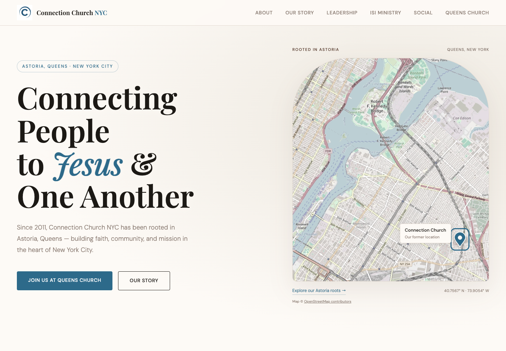

<div align="center">


# Connection Church NYC

**Remembering the community. Preserving the messages. Continuing the mission.**

A church legacy website and searchable sermon archive from Astoria, Queens.

[Visit the website](https://connectionnyc.net/) · [Explore sermons](https://connectionnyc.net/sermons/) · [Browse the calendar](https://connectionnyc.net/sermons/calendar/)

</div>



## A lasting home for Connection’s story

Connection Church NYC began in Astoria in 2011, founded by the McGhee and Mayberry families. In 2024, the church merged with [Queens Church](https://www.qns.church/), where the mission continues.

This website preserves Connection’s history, celebrates the people behind its ministry, and helps visitors return to the sermon recordings that remain available on YouTube.

## Explore the website

| Experience | What you’ll find |
| :--- | :--- |
| [Church home](https://connectionnyc.net/) | Connection’s story, an Astoria neighborhood map, the Queens Church update, social links, and ministry partners. |
| [Sermon library](https://connectionnyc.net/sermons/) | Available YouTube recordings, title and description search, and spoken-word search for messages with imported transcripts. |
| [Sermon calendar](https://connectionnyc.net/sermons/calendar/) | Messages organized by date to revisit a Sunday or explore a month and year. |
| [Leadership](https://connectionnyc.net/#leadership) | Ministry portraits and updates for Daniel and Kari McGhee and Larry and Lindsey Mayberry, with links to ISI, Queens Church, and MNYBA. |

Both the homepage and sermon archive support responsive layouts and light and dark themes. A visitor’s theme preference is saved locally.

## Sermon archive at a glance

| Catalog snapshot | Status |
| :--- | :--- |
| **28 messages** | Public library entries with matched YouTube recordings. |
| **410 records** | Preserved metadata without matched recordings, kept in an unlisted catalog. |
| **438 total records** | Historical podcast catalog spanning 2014–2024. |
| **1 caption pilot** | *I Believe #11 — Repent and Believe*: 934 automatic caption segments, grouped into 41 overlapping search passages. |

These counts describe the current checked-in catalog and change as recordings are matched or captions are imported.

**What search covers:** titles and descriptions are searchable across the public library. Spoken-word search is available for imported transcripts; timestamp links follow the YouTube recording’s timeline. Automatic captions are unreviewed—check wording, names, Scripture references, and timing against the video before quoting.

The original Buzzsprout feed was empty when checked, and tested saved audio URLs returned 404. Podcast listings preserve useful metadata but do not establish that playable audio is recoverable. Descriptions are kept as metadata, never presented as transcripts. YouTube matches use normalized titles; matching titles alone does not establish identical edits or timestamps.

<details>
<summary><strong>How the unlisted catalog works</strong></summary>

The [preserved catalog](https://connectionnyc.net/sermons/catalog-archive/) contains the 410 records without matched YouTube recordings. It supports metadata search and stays out of the public navigation, library, calendar, and rendered search results.

The page is marked `noindex,nofollow,noarchive`. **It is unlisted, not password protected.** Anyone with the URL can open it, and the underlying D1 read APIs still expose the full historical metadata catalog.

All 438 records remain in the source JSON and D1 database. Adding a verified `youtube_url` to a source record and rebuilding moves that record into the public library automatically.

</details>

## Built with

- **HTML, CSS, and browser JavaScript** for the homepage and sermon interfaces.
- **Cloudflare Pages** for static hosting, with Pages Functions serving `/api/sermons/*`.
- **Cloudflare D1** for catalog metadata, transcript passages, and spoken-word search.
- **Node.js** for building the published files; **TypeScript** for the API.
- **Locally hosted fonts and map assets**, including an OpenStreetMap-based hero map.

The archive adapts the Skyline Echo sermon experience for Connection. It uses its own `connection-sermons` database and does not query or modify Skyline’s database.

**Builds and deployments do not run transcription, paid AI calls, or scheduled jobs.** Contextual search requires additional configuration; this version falls back to keyword search.

## Run locally

Install Node.js with npm. Cloudflare account access is required for remote database operations and deployment.

```sh
npm ci
npm run db:local
npm run dev
```

Open the local URL printed by Wrangler. The homepage is at `/`; the sermon library is at `/sermons/`.

| Command | Purpose |
| :--- | :--- |
| `npm run dev` | Build and run the site with local Pages Functions. |
| `npm run build` | Generate `dist/`, split public and unlisted catalog records, and version sermon CSS/JS URLs. |
| `npm run db:local` | Apply D1 migrations to the local development database. |
| `npm test` | Exercise D1 search, timestamped results, transcript publishing, validation, and retries. |
| `npm run check` | Generate Cloudflare binding types and run TypeScript checks. |

For a static-only preview, run `npm run build`, then `python3 -m http.server 8000 --directory dist`. Catalog browsing works from the generated JSON; backend transcript search requires Pages Functions and D1.

## Deploy to Cloudflare Pages

The existing Pages project is **`connectionchurchnyc`**. Its build command is `npm run build` and its output directory is `dist`. The D1 binding is defined in [`wrangler.jsonc`](wrangler.jsonc).

After authenticating Wrangler to the correct Cloudflare account:

```sh
npx wrangler d1 migrations apply DB --remote
npm run build
npx wrangler pages deploy dist --project-name connectionchurchnyc --branch main
```

Apply new migrations before deploying changes that depend on them. Commit new numbered migrations rather than editing migrations that have already been applied.

The generated `dist/_routes.json` limits Functions to `/api/sermons/*`; other pages are served as static files. Preview deployments use the same configured D1 binding, so writable publishing tests should use a separate database.

## Project map

```text
connectionchurchnyc/
├── index.html                 # Church homepage and inline homepage styles
├── assets/
│   ├── leaders/               # Ministry portraits and source credits
│   ├── sermons/               # Source catalog, scripts, styles, and fonts
│   └── …                      # Church logos, maps, and homepage preview
├── sermons/
│   ├── index.html             # Public sermon library and search
│   ├── calendar/              # Date-based sermon browsing
│   └── catalog-archive/       # Unlisted preserved catalog
├── functions/api/sermons/     # Cloudflare Pages API entry point
├── worker/                    # Search and transcript publishing logic
├── migrations/                # D1 schema and content migrations
├── scripts/                   # Build, catalog, captions, and map tools
├── tests/                     # Search and publishing tests
├── archive/                   # Preserved alternate church page
├── wrangler.jsonc             # Pages and database configuration
└── dist/                      # Generated deployment output
```

## Maintaining the archive

<details>
<summary><strong>Match recordings and import captions</strong></summary>

[`scripts/import-podcast-catalog.py`](scripts/import-podcast-catalog.py) refreshes metadata from public listing pages and preserves existing video-source annotations. It does not download audio.

For a verified matching video, add its `youtube_url` to the corresponding record in [`assets/sermons/catalog.json`](assets/sermons/catalog.json). Then import a timestamped browser-exported caption file:

```sh
python3 scripts/import-youtube-captions.py EPISODE_ID VIDEO_ID captions.txt migrations/0007_next_caption_import.sql
```

Choose the next unused migration number. The importer checks the video ID against the catalog source, retains the original caption words, validates ordering, and generates an idempotent per-episode import. Apply the migration to the intended database and rebuild the site.

</details>

<details>
<summary><strong>Publish transcripts or enable contextual search</strong></summary>

The protected `POST /api/sermons/admin/transcripts` endpoint accepts timestamped JSON from a reviewed transcript or a future transcription runner. It remains closed until a server-side `TRANSCRIPT_PUBLISH_TOKEN` is configured.

Payloads include `episode` metadata, `segments` containing `start`, `end`, and `text`, and optional `dry_run` (which defaults to `true`). Synthetic samples can only be validated. Publication is transactional and retry-safe. Keep credentials out of Git and frontend code.

Meaning-based search requires a separately configured Vectorize index, indexed embeddings, and a server-side OpenAI key. Those resources are not enabled in this version; keyword search remains available.

</details>

<details>
<summary><strong>Update maps and photography</strong></summary>

The homepage hero map marks Connection’s former location at **40.7567285, -73.9053766**, rather than the current Queens Church meeting location. Its image and pin share a Web Mercator projection and scale together without cropping.

To regenerate the checked-in map, run `python3 scripts/build-astoria-map.py` with Pillow installed. This optional maintenance tool downloads only the required map tiles. Retain the visible [OpenStreetMap attribution](https://www.openstreetmap.org/copyright). The original terracotta Astoria map was created with [terraink](https://github.com/bstef/terraink).

Leadership photos come from official ministry websites. See [`assets/leaders/README.md`](assets/leaders/README.md) for image sources and credits.

</details>

## Ministry & community links

[Queens Church](https://www.qns.church/) · [The McGhees’ ISI ministry](https://internationalstudents.org/team/mcghees/) · [MNYBA](https://www.mnyba.org/about/)

[YouTube](https://www.youtube.com/@connectionchurchnyc) · [Instagram](https://www.instagram.com/connectionnyc/) · [Facebook](https://www.facebook.com/connectionnyc/) · [Original blog](https://connectionnyc.blogspot.com/)

## License & credits

Repository code is provided under [GNU GPL v3](LICENSE). Ministry photography and other third-party assets retain their respective rights and attributions. Bundled fonts include their own license files in `assets/sermons/fonts/`.
